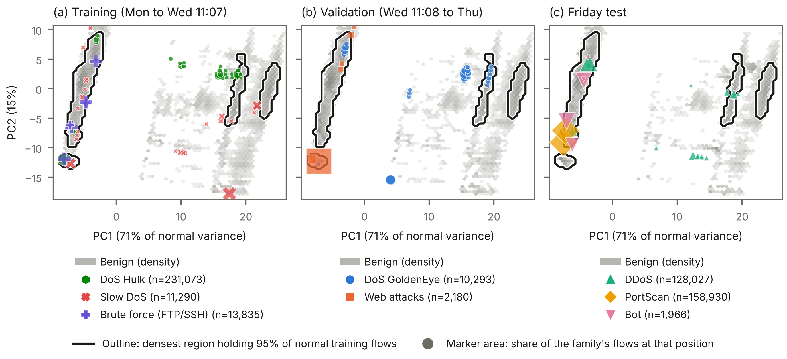
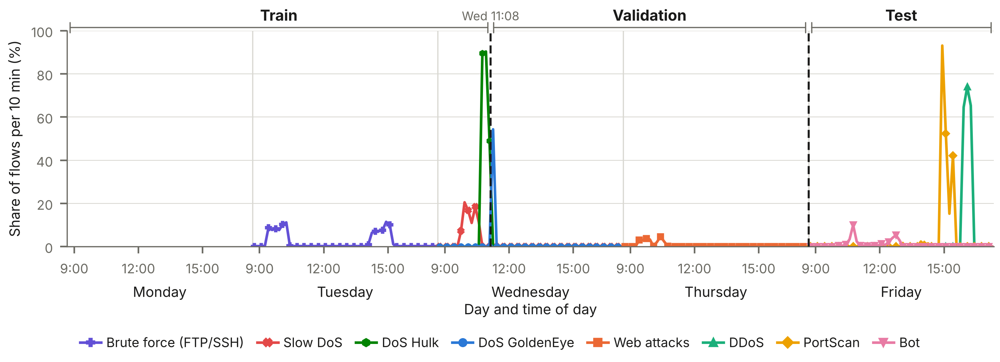

# Finding the Needle in the Flow: Anomaly Detection Under Extreme Class Imbalance

2026 NYCU Data Mining HW2，Team 6。在 CIC-IDS2017 上比較三種方法偵測「沒看過的攻擊」的能力：

| Tier | 方法 | 訓練資料 | 程式位置 |
|---|---|---|---|
| 1 | 單一特徵門檻（Bwd Packet Length Max） | 只用正常流量的中位數與 IQR | `tier1_single_feature/` |
| 2 | kNN 異常偵測（k=5，32,768 筆正常參考流量），主要方法 | 只用正常流量 | `tier2_knn/` |
| 3 | XGBoost（監督式） | 含攻擊標籤的訓練流量 | `tier3_xgboost/` |

- **報告**：[`report/HW2_G06_report.pdf`](report/HW2_G06_report.pdf)（6 頁正文 + 參考文獻）
- **簡報**：[`report/HW2_G06_presentation.pdf`](report/HW2_G06_presentation.pdf)（24 頁）
- 報告用到的圖在 `figures/`。

## 主要結果

研究問題：只用正常流量訓練的異常偵測 IDS，能不能在高度不平衡的真實流量中可靠地找出罕見的入侵？
資料依時間切分，週五測試集的三種攻擊（Bot、PortScan、DDoS）在訓練與驗證階段都沒出現過。

| 方法 | Test AP | Test AUROC | F1@τ | Recall@τ | FPR@τ |
|---|---:|---:|---:|---:|---:|
| 全部判為攻擊（參考） | 0.411 | 0.500 | 0.582 | 1.000 | 100% |
| Tier 1 單一特徵 | 0.577 | 0.762 | **0.510** | **0.443** | 20.54% |
| Tier 2 kNN（主要方法） | **0.798** ± 0.023 | **0.921** ± 0.003 | 0.200 ± 0.042 | 0.117 ± 0.029 | **3.48%** ± 1.20 |
| Tier 3 XGBoost | **0.782** ± 0.008 | 0.858 ± 0.006 | 0.431 ± 0.010 | 0.297 ± 0.010 | **5.56%** ± 0.39 |

3 seeds 的 mean ± std；τ 由驗證集的最佳 F1 決定後固定。粗體為該欄最佳，以及與最佳沒有顯著差異者。

- **答案是「只有部分可以」**。kNN 對沒看過的攻擊排序最好（AUROC 0.921），但在固定門檻下只抓到 11.7% 的攻擊。
- **問題出在門檻，不在偵測器**。驗證集的攻擊有 82% 是 GoldenEye，選出的門檻太嚴；改用 Tier 1 的誤報率時，kNN 的 Recall 是 99.4%。
- **單一特徵贏在 F1，是因為剛好對上一種攻擊**。它 127,937 個 TP 中有 126,797 個來自 DDoS。三個方法的 F1 都低於「全部判為攻擊」。
- **三個方法有共同盲點**。PortScan 與 Bot 單看一筆流量和正常流量無法區分，需要以來源為單位的特徵。
- **標籤錯誤影響評估**。週五有 32,314 筆標為 BENIGN 的流量其實介於受害主機與攻擊者之間，約占 kNN 誤報的 94%。

## 組員與分工

| 組員 | 學號 | 負責內容 | 對應的程式或檔案 |
|---|---|---|---|
| 林程亮 | 112550125 | 撰寫 §3 任務定義與資料（表 2）；製作簡報 | `report/` |
| 林庠安 | 315551119 | EDA 與資料前處理 | `preprocess.py` |
| 林景玄 | 315551127 | Tier 1 程式與結果（表 3、5、6）；Tier 1 錯誤分析（§8） | `tier1_single_feature/`、`docs/error_analysis_tier1.md` |
| 郭佳翰 | 315551137 | Tier 3 程式與結果（表 3、5）；Tier 3 分析（§7、§8） | `tier3_xgboost/`、`docs/failure_analysis_tier3.md` |
| 林李奕 | 315553025 | Tier 2 程式與結果（表 3、5、6）；Tier 2 分析（§7、§8） | `tier2_knn/`、`docs/failure_analysis_tier2.md` |
| 王裕昕 | 315554006 | EDA 與資料前處理 | `preprocess.py` |
| 顏丞硯 | 315554021 | 題目發想；撰寫 §1；製作 Introduction 與 Results 簡報 | `report/` |
| 林群佑 | 315554038 | 統籌；撰寫 §2；整合 §7–§9；圖 1 與圖 3 | `analysis/`、`figures/` |

分工內容與報告的「Contributions of Each Member」一致。

**AI 使用聲明。** 我們使用 Claude Fable 5.2 起草與修改文字、撰寫作圖與消融實驗的腳本、執行 Tier 2 消融實驗，並對照原始資料核對數字；使用 Claude Opus 5.5 寫程式；使用 GPT 6.1 sol 寫程式與審閱。方法、實驗設計與所有結論由組員決定並確認。

---

## 1. 目錄結構

```
.
├── preprocess.py               共用前處理：清理、時間切分、特徵矩陣（所有 Tier 共用）
├── preprocess_lowmem.py        同一套規則的低記憶體版本（RAM 不足時使用）
├── requirements.txt            前處理與 analysis/ 的套件版本
├── TrafficLabelling/           ← 自行放入 8 個原始 CSV（不進版控）
├── artifacts/                  ← preprocess.py 產生（約 1.3 GB，不進版控）
├── tier1_single_feature/       Tier 1 程式與結果
├── tier2_knn/                  Tier 2 程式、固定設定與結果
├── tier3_xgboost/              Tier 3 程式（自帶一份 preprocess.py 與環境）
├── analysis/                   圖、消融實驗、事後分析、數字核對
├── results/                    analysis/ 的輸出（已附上我們跑出的結果）
├── figures/                    報告用圖（PNG 供連結，PDF 供 LaTeX）
├── report/                     繳交的報告與簡報（PDF）
└── docs/                       各 Tier 的錯誤分析筆記
```

## 2. 資料

- 來源：UNB CIC-IDS2017，<https://www.unb.ca/cic/datasets/ids-2017.html>
- 下載 **GeneratedLabelledFlows.zip**（含 Flow ID、IP、Timestamp 的版本，不是 MachineLearningCVE）。
- 解壓後把資料夾命名為 `TrafficLabelling`（原始資料夾名稱結尾有一個空白，請去掉），放在 repo 根目錄，內含 8 個檔案：

```
TrafficLabelling/
├── Monday-WorkingHours.pcap_ISCX.csv
├── Tuesday-WorkingHours.pcap_ISCX.csv
├── Wednesday-workingHours.pcap_ISCX.csv
├── Thursday-WorkingHours-Morning-WebAttacks.pcap_ISCX.csv
├── Thursday-WorkingHours-Afternoon-Infilteration.pcap_ISCX.csv
├── Friday-WorkingHours-Morning.pcap_ISCX.csv
├── Friday-WorkingHours-Afternoon-PortScan.pcap_ISCX.csv
└── Friday-WorkingHours-Afternoon-DDos.pcap_ISCX.csv
```

資料不隨 repo 提供。

## 3. 環境

三個 Tier 由不同組員在不同機器上完成，環境如下。

| 用途 | Python | 主要套件 | 硬體 |
|---|---|---|---|
| 前處理、`analysis/` | 3.13 | 見 `requirements.txt`（numpy 2.5.3、pandas 3.0.5、scipy 1.18.1、scikit-learn 1.9.1、matplotlib 3.11.2、pyarrow） | CPU，約 7 GB RAM |
| Tier 1 | 同上即可 | numpy、pandas、pyarrow、scikit-learn | CPU |
| Tier 2 | Linux | PyTorch 2.5.1+cu124、numpy、pandas、pyarrow、scikit-learn、joblib | NVIDIA RTX 3080（需 6 GiB 以上可用顯存） |
| Tier 3 | 3.14 | 見 `tier3_xgboost/requirements.txt`（xgboost 3.4.1、pandas 3.1.0 等，`uv export` 產生） | Apple M5（macOS 需 `brew install libomp`） |

```sh
python -m venv .venv && source .venv/bin/activate
pip install -r requirements.txt
```

## 4. 復現步驟

以下指令都在 repo 根目錄執行。

### 步驟 0：前處理（一次）

```sh
python preprocess.py            # 約 16 GB RAM；記憶體不足時改用 python preprocess_lowmem.py
```

產生 `artifacts/`：`X_raw.npy`、`X_scaled.npy`、`splits.npz`、`meta.parquet`、`features.json`、`preprocess_params.json`。
程式會自動檢查切分結果，必須等於下表，否則中止：

| Split | 時段 | Flows | 攻擊 | 攻擊比例 |
|---|---|---:|---:|---:|
| Train | 週一 ～ 週三 11:07 | 1,362,859 | 256,198 | 18.80% |
| Validation | 週三 11:08 ～ 週四 | 764,639 | 12,525 | 1.64% |
| Test | 週五 | 703,245 | 288,923 | 41.08% |

> **重要：去重後的正常訓練流量筆數會隨 pandas 版本改變。** 詳見第 7 節。`preprocess.py` 斷言這個數字是 848,406；
> 若你的環境得到別的數字，`preprocess.py` 會在該行中止，請改用 `preprocess_lowmem.py`（只印出、不斷言）
> 或 `tier3_xgboost/prepare_data.py` 的做法。Validation 與 Test 的列不受影響。

### 步驟 1：Tier 1（單一特徵）

```sh
python tier1_single_feature/baseline.py --no-excel               # 驗證集，選出門檻
python tier1_single_feature/baseline.py --final-test --no-excel  # 週五測試，只能執行一次
```

輸出寫在 `tier1_single_feature/`：`results_val.json`、`results_test.json`、`metrics_*.csv`、`by_attack_*.csv`、`predictions_*.parquet`。
我們的結果已附在 `tier1_single_feature/results/`（Excel）。
`--final-test` 會建立 `FINAL_TEST_STARTED.json`，同一資料夾無法再跑第二次；它也會核對 `preprocess_params.json` 的雜湊值，環境不同時會拒絕執行（見第 7 節）。

### 步驟 2：Tier 2（kNN）

Tier 2 的程式假設 `artifacts/` 在程式所在的資料夾，先建立連結：

```sh
ln -s ../artifacts tier2_knn/artifacts
cd tier2_knn

# (a) 驗證集：比較 kNN 與 Isolation Forest，並為每個 seed 選出 kNN 門檻
CUDA_VISIBLE_DEVICES=0 python tier2_alternatives.py --output runs/alternatives

# (b) 週五測試：沿用已固定的門檻（validation_config.json 即 (a) 的 kNN 結果）
CUDA_VISIBLE_DEVICES=0 OMP_NUM_THREADS=2 OPENBLAS_NUM_THREADS=2 MKL_NUM_THREADS=2 \
  taskset -c 0-3 python tier2_knn_final.py --validation validation_config.json --output runs/knn_reproduction
cd ..
```

- `tier2_ae.py`、`tier2_ae_refine.py` 是開發期間的 autoencoder 嘗試，同時提供 `tier2_alternatives.py` 用到的共用函式，請保留。
- 需要 Linux（讀 `/proc/stat` 監控 CPU）與一張 GPU。
- 我們的正式結果在 `tier2_knn/results_final/`：`summary.json`（逐 seed 指標）、`locked_config.json`（固定設定與資料指紋）、兩個 Excel。
- `tier2_knn_final.py` 會核對 `splits.npz` 的雜湊值與 848,406 這個筆數，環境不同時會中止（見第 7 節）。

### 步驟 3：Tier 3（XGBoost）

Tier 3 自成一個資料夾，用自己的 `preprocess.py` 副本與環境重建 `artifacts/`：

```sh
cd tier3_xgboost
ln -s ../TrafficLabelling TrafficLabelling
uv venv --python 3.14 && uv pip install -r requirements.txt
uv run python prepare_data.py        # 一次，產生 tier3_xgboost/artifacts/
uv run python xgb_tier3.py           # 選參數 + 3 seeds，只用 val
uv run python xgb_tier3.py --test    # 週五測試，只跑一次
cd ..
```

跑完後可以選擇執行 `uv run python check_tier3.py`，把重跑結果與報告中的 Tier 3 數字並列。

結果寫在 `tier3_xgboost/results/xgb/`（`summary_val.json`、`summary_test.json`、逐 seed 的模型與分數）。細節見 `tier3_xgboost/README.md`。
`ecod_tier3.py` 是另一個未列入報告的非監督基準。

### 步驟 4：圖、消融實驗與分析

```sh
python analysis/make_figures.py      # 圖 1、圖 3 與兩張補充圖           → figures/
python analysis/eda_train.py         # §4 的 KS 距離與相關係數（只用訓練集） → results/eda_ks.csv
python analysis/knn_ablation.py      # 表 4：kNN 消融（只用驗證集，約 20 分鐘） → results/knn_ablation_results.jsonl
python analysis/tier2_posthoc.py     # §7–8 的 Tier 2 事後分析（約 30 分鐘）   → results/tier2_posthoc.json
python analysis/verify_numbers.py    # 內文引用的筆數、案例列的原始特徵值
python analysis/significance.py      # 顯著性檢定
```

`analysis/` 全部在 CPU 上執行，kNN 用 numpy 精確計算，與 Tier 2 的 GPU 版本定義相同（同 seed、同抽樣規則）。

## 5. 報告中每張表、每張圖的來源

表與圖的編號以 `report/HW2_G06_report.pdf` 為準。

| 報告位置 | 內容 | 指令或檔案 |
|---|---|---|
| 表 1 | 文獻設定比較 | 手動整理（文獻列於報告的 References） |
| 表 2 | 資料切分 | `preprocess.py` 內的斷言；`analysis/verify_numbers.py` |
| 圖 1 | 訓練集的 Bwd Packet Length Max 分布 | `analysis/make_figures.py` → `figures/fig_eda_feature.*` |
| §4 數字 | KS 距離、Spearman 相關 | `analysis/eda_train.py` |
| 圖 2 | 方法流程圖 | 以 TikZ 繪製，不涉及資料；輸出檔為 `figures/fig_pipeline.*` |
| 表 3 的粗體 | 與最佳無顯著差異的判定 | `analysis/significance.py`（Welch t 檢定） |
| 表 3 | 主結果 | Tier 1：`tier1_single_feature/baseline.py`；Tier 2：`tier2_knn/tier2_knn_final.py`；Tier 3：`tier3_xgboost/xgb_tier3.py` |
| §7.1 的檢定 | t 檢定、全判攻擊的 F1 | `analysis/significance.py` |
| §7.1 同 FPR 的 Recall、事後最佳 F1、可疑流量 | Tier 2 部分 | `analysis/tier2_posthoc.py`；可疑流量筆數：`analysis/verify_numbers.py` |
| 表 4 | kNN 消融 | `analysis/knn_ablation.py` |
| 圖 3 | PCA（訓練、驗證、週五） | `analysis/make_figures.py` → `figures/fig_pca.*`；圈內比例在 `results/fig_pca_region_shares.csv` |
| 表 5 | 各攻擊家族的 Recall 與 AUROC | Tier 1：`by_attack_test.csv`；Tier 2：`summary.json` 與 `analysis/tier2_posthoc.py`；Tier 3 的 DDoS AUROC 未計算（表中為「–」） |
| 表 6 | 失效案例 | 原始特徵值與 Tier 1 分數：`analysis/verify_numbers.py`；Tier 2 分數與各特徵占比：`analysis/tier2_posthoc.py` |
| §8.2 警報量 | 每抓到一筆攻擊的誤報數 | `analysis/verify_numbers.py` |

**目前無法由本 repo 直接重現的數字**（由負責的組員另行計算，程式尚未併入）：

- §7.1 的 Shapley 分解（−0.447、−0.137、+0.131）。
- Tier 3 的事後分析：SHAP 值、Spearman ρ = 0.996。
- Tier 3 的同 FPR Recall（0.712）、排除可疑流量後的 AP（0.799）、各家族 AUROC、22 埠的 FPR：原始計算程式未併入。`tier3_xgboost/check_tier3.py` 可在跑完步驟 3 後由存下的分數重算這幾項並與報告數字並列，但這支腳本尚未用正式結果驗證過。
- §8.1「最近的訓練流量為正常」的比例（99%、100%）。

## 6. 隨機種子

| 用途 | Seeds |
|---|---|
| 前處理、Tier 3 的 holdout 切分 | 20261101 |
| Tier 1（確定性方法，seed 不影響結果） | 20261101–20261103 |
| Tier 2（每個 seed 抽不同的 32,768 筆參考流量）、`analysis/` 的 kNN | 20261104、20261105、20261106 |
| Tier 3（XGBoost `random_state`） | 20261101、20261102、20261103 |

所有 seed 都寫在程式裡，沒有未固定的隨機性。Tier 2 與 Tier 3 用不同的 seed 組，所以兩者之間的檢定是非配對的（Welch t 檢定）。

## 7. 已知的重現性限制

**去重筆數與 pandas 版本。** 訓練集去重後的正常流量筆數會隨 pandas 版本不同：

| 環境 | 去重後的正常訓練流量 |
|---|---:|
| Tier 1、Tier 2 的原始環境 | 848,406 |
| Tier 3（pandas 3.1.0） | 848,433 |
| `analysis/` 的環境（pandas 3.0.5） | 848,382 |

影響範圍：

- Validation 與 Test 的列在三個環境完全相同（列索引的 SHA-256 一致），所以評估資料不受影響。
- 縮放參數與 kNN 的參考樣本會有極小差異，所以 `analysis/` 的 CPU 重跑與正式結果不會逐位相同，但都落在 seed 的變動範圍內（3 seeds，mean ± std）：

| Tier 2 指標 | 正式結果（`tier2_knn/results_final/`） | CPU 重跑（`results/`） |
|---|---:|---:|
| Validation AP | 0.449 ± 0.036 | 0.452 ± 0.057 |
| Validation F1@τ | 0.653 ± 0.010 | 0.650 ± 0.005 |
| Test AP | 0.798 ± 0.023 | 0.809 ± 0.036 |
| Test AUROC | 0.921 ± 0.003 | 0.921 ± 0.006 |
| Test F1@τ | 0.200 ± 0.042 | 0.235 ± 0.039 |
| Test Recall@τ | 0.117 ± 0.029 | 0.139 ± 0.024 |
| Test FPR@τ | 3.48% ± 1.20% | 3.14% ± 1.85% |
| Recall（Tier 1 的 FPR 下） | 0.994 | 0.991 ± 0.002 |
| Recall（Tier 3 的 FPR 下） | 0.364 | 0.370 ± 0.002 |
| 事後最佳 F1 | 0.91 | 0.898 ± 0.003 |
| 可疑流量占誤報比例 | 94.5% | 89.5% ± 9.5% |
| 排除可疑流量後的 AP | 0.96 | 0.958 ± 0.002 |

- 表 6 中 Tier 2 各案例的分數與是否越過門檻取決於實際抽到的參考樣本，只有在原始環境才能逐位重現；`analysis/tier2_posthoc.py` 在其他環境會給出相近的分數與相同的主導特徵。
- Tier 1 的 `--final-test` 與 Tier 2 的 `tier2_knn_final.py` 會核對雜湊值，只有在得到 848,406 的環境才會執行。其他環境請以 `analysis/` 的 CPU 重跑對照，或直接檢視附上的結果檔。

**測試集的使用。** 每個 Tier 的固定設定只在週五測試集上正式評估一次，程式以鎖定檔防止重跑。`analysis/tier2_posthoc.py` 以及 `docs/` 中的事後分析在此之後使用了週五的標籤，僅供診斷，沒有用來選模型或門檻。

**標籤。** CIC-IDS2017 有已知的標籤錯誤（Engelen et al., 2021）。本 repo 使用原始標籤，沒有修正。

## 8. 圖檔

`figures/` 內每張圖都有 PNG（400 dpi）與 PDF。

| 檔案 | 報告位置 | 內容 |
|---|---|---|
| `fig_eda_feature` | 圖 1 | 訓練集中 Bwd Packet Length Max 的分布（依攻擊家族） |
| `fig_pipeline` | 圖 2 | Tier 2 的流程 |
| `fig_pca` | 圖 3 | 以正常訓練流量擬合的 PCA：訓練、驗證、週五 |
| `fig_traffic_timeline` | 補充（未放入報告） | 週一到週五各攻擊家族占流量的比例，標出 train / val / test 的切分點 |
| `fig_tier1_feature` | 補充（未放入報告） | 週五的 Bwd Packet Length Max 與 Tier 1 的判定區間 |



